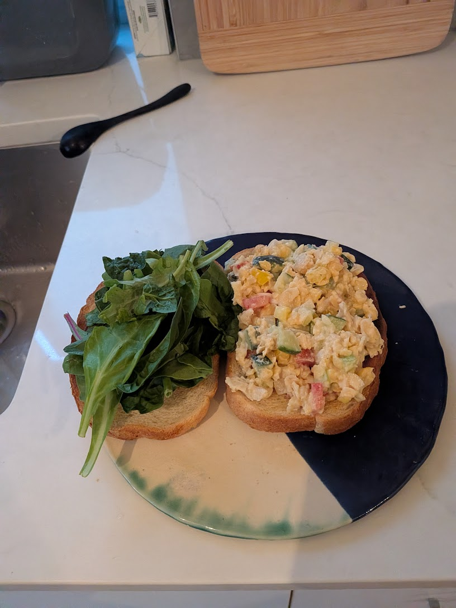

::: {.lead .tagline-banner}
*fostering environmental sustainability, resilient systems, and human connection through data, art, and community*
:::

### micro biography

Chloe (**she/her**) is a data scientist, quantitative analyst, and long-time visual artist originally from Philadelphia and currently based in Vancouver. She believes the most impactful solutions arise when you combine rigorous analytics, thoughtful design, and genuine human connection—and she builds both her technical work and creative practice around this principle.

She is currently pursuing her **Master of Data Science (MDS)** at the **University of British Columbia (UBC)**, building on a **B.B.A. in Economics** from **Temple University** and prior quantitative business experience at **Janney Montgomery Scott** and **Kenvue**. Her technical work focuses on **Quantitative Risk Modeling**, **Model Risk Management (MRM)**, econometric stress testing, and reproducible machine learning workflows.

---

### snapshot & background

:::: {.columns}

::: {.column width="58%"}
- **Current Program**: Master of Data Science, University of British Columbia (Vancouver, BC)
- **Undergraduate Pedigree**: B.B.A. in Economics, Temple University (Philadelphia, PA)
- **Industry Experience**: Quantitative & analytical roles at Janney Montgomery Scott and Kenvue
- **Technical Focus**: Credit & market risk modeling (1st Line), independent model validation & governance (2nd Line, SR 11-7 / OSFI E-23), Python, R, SQL, and statistical inference
- **Outside the Terminal**: Exploring Vancouver coffee spots, dancing, drawing, collage/animation, and unwinding with music and a good book
:::

::: {.column width="42%"}
{.rounded-photo width="85%"}
:::

::::

---

### explore this site

:::: {.grid}

::: {.g-col-12 .g-col-md-6 .nav-card}
#### [Risk & Validation Projects →](risk-validation.qmd)
Technical papers, 3-act model validation reports (Quant Build, MRM Audit, Governance Synthesis), audited GitHub repositories, and interactive risk applications developed across the UBC MDS curriculum.
:::

::: {.g-col-12 .g-col-md-6 .nav-card}
#### [Arts & Draft →](arts-and-drafts.qmd)
Multi-medium visual arts portfolio—sketches, collage, digital illustration, and rough animation works by **Phuong Lan Tanaka** (2020–2025).
:::

::::
